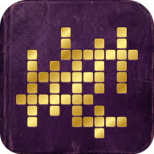
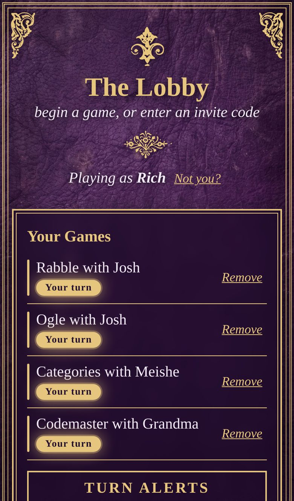
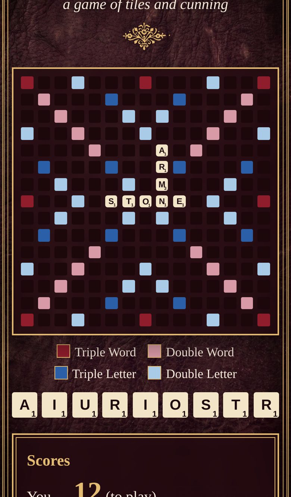
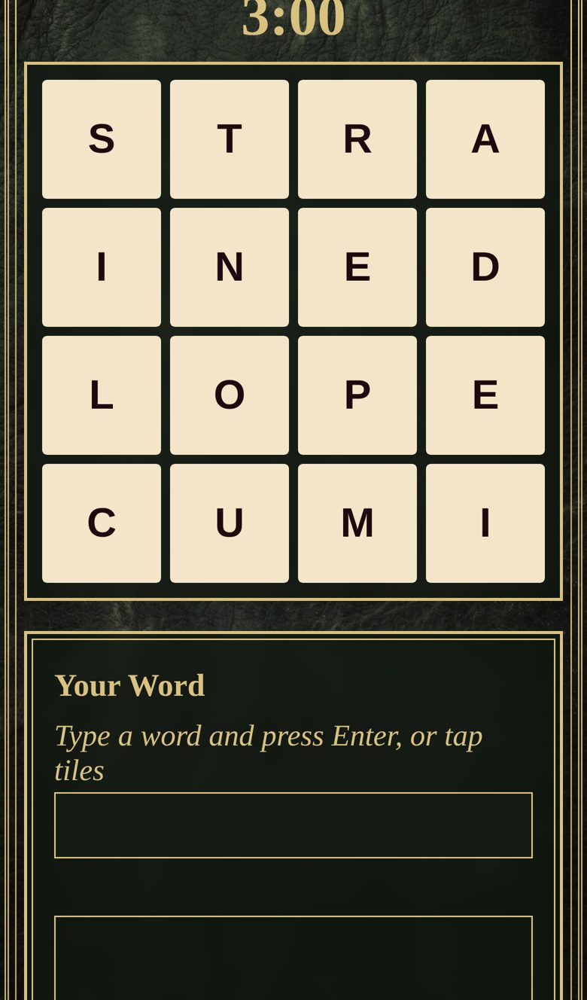
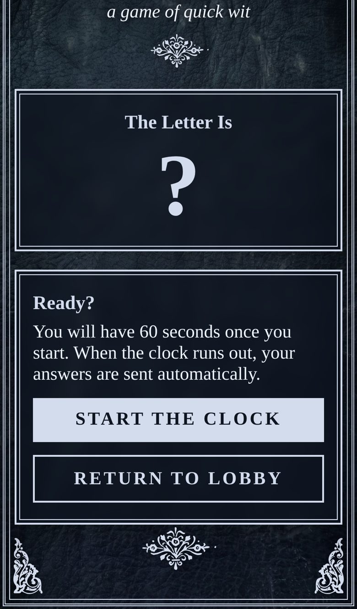
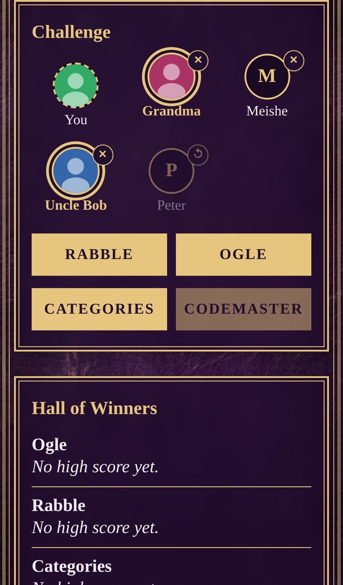
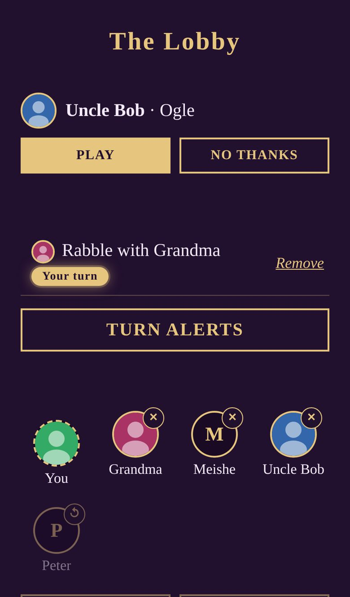

<h1 align="center">Word Games</h1>
<h3 align="center">Four games. Every time zone. One turn at a time.</h3>

<a href="https://joshp523.github.io/Word-Games/"><b>▶ Open the app</b></a>

<table><tr>
<td align="center"> <b>The Lobby</b></td>
<td align="center"> <b>Rabble</b></td>
<td align="center"> <b>Ogle</b></td>
<td align="center"> <b>Categories</b></td>
</tr></table>

## ✦ New: challenge anyone
<table><tr><td align="center"> <b>Challenge</b></td><td align="center"> <b>Understated</b></td></tr></table>

**Everyone, in one place.** Every player appears in the lobby with their own picture. Tap a face or three, tap a game, and the challenge is on.

**Your face, your way.** Tap your own circle to add a photo. It follows you into every game.

**Challenges arrive instantly.** A buzz on their phone, a card in their lobby: *Play* or *No thanks.*

**Ornate or Understated.** Love the leather and gold filigree? Keep it. Want nothing but the game? One tap at the bottom of the lobby strips it back to just the name and the play.

Invite codes still work too, right at the bottom.

## ✦ Your move. Instantly.
**Turn alerts, rebuilt.** The moment someone plays, the next player's phone buzzes. Every move, every join, every word dispute. Never twice.

**A lobby that keeps up.** It refreshes itself. Games waiting on *you* rise to the top and glow, and the count rides on your home-screen icon.

**Test it yourself.** One tap sends a test alert to your phone, and tells you in plain words if something's off.

## ✦ Four games, one leather-bound parlor
- **Rabble.** Tiles and cunning, on a full 15×15 board.
- **Ogle.** Three minutes, sixteen letters, as many words as you can trace.
- **Categories.** One letter, twelve categories, sixty seconds.
- **Codemaster.** Win together, or fall together.

## ✦ Made for every eye
**Hyperlegible tiles.** Rabble and Ogle tiles use Atkinson Hyperlegible, the typeface designed by the Braille Institute. Clear on the smallest phone.

## ✦ Fair play, built in
**"Is that a word?"** In Rabble, a word that isn't in the dictionary goes to your opponent. They look it up and decide. Allowed words count for everyone from then on.

**173,000-word dictionary.** Checked instantly, right on your phone.

## ✦ Play anywhere
Two to four players, solo practice, invite links, a Hall of Winners, and no app store required.

---

### On your phone
Open the link in Safari (iPhone/iPad) or Chrome (Android), then choose **Share → Add to Home Screen**. It gets its own icon and opens full-screen, just like an app from the store.

### More apps by Josh Riley
[The Riley Rag](https://joshp523.github.io/RileyRag/) · [QuipRash](https://joshp523.github.io/Quip-game-app/) · [Russian Verbs](https://joshp523.github.io/russian/) · [Riley Rangers](https://joshp523.github.io/Rangers-app/) · [Habits: Josh](https://joshp523.github.io/daily-discipline/) · [Habits: Meishe](https://joshp523.github.io/Habit-tracker-app-Meishe/) · [Habits: Grandma](https://joshp523.github.io/wendys-app/) · [Writing](https://joshp523.github.io/writing-app/)

Built by Josh Riley. Setup notes for whoever maintains it are in [SETUP.md](SETUP.md).
