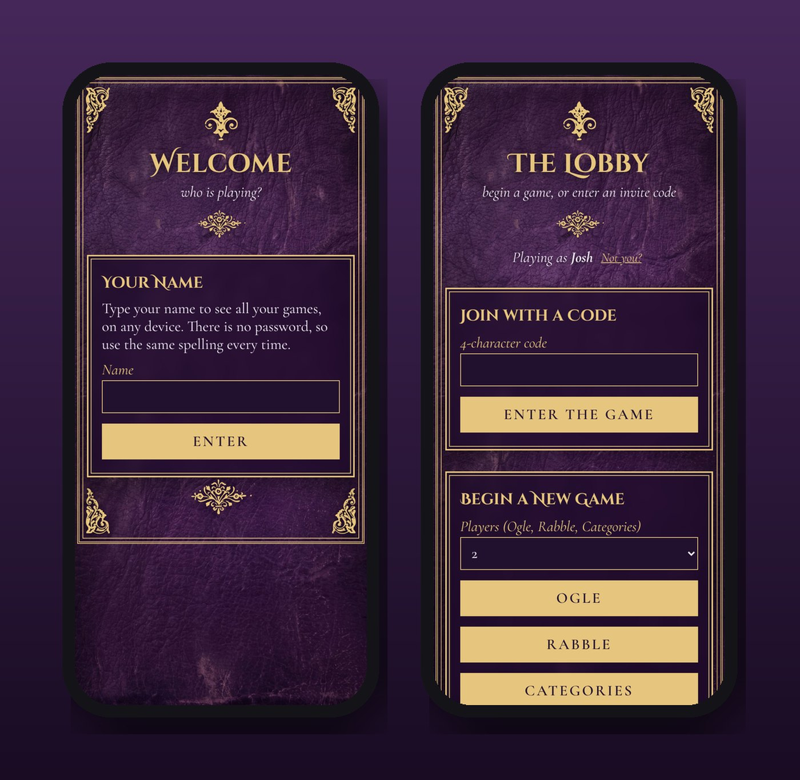
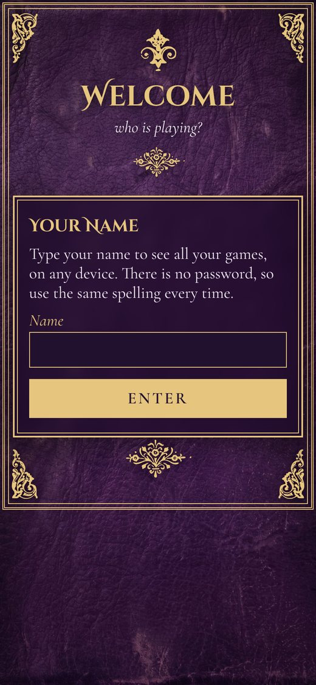
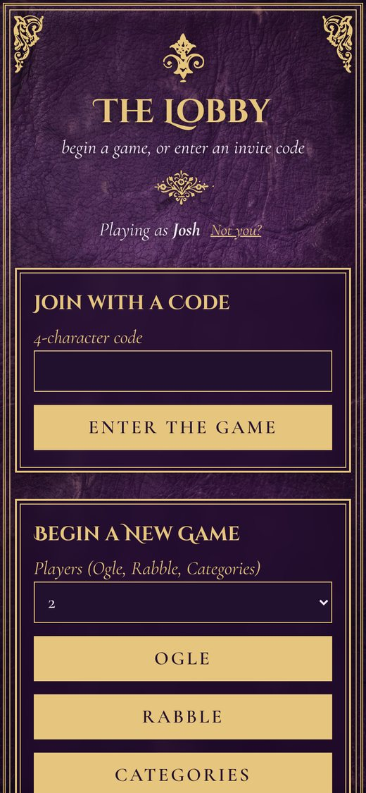

<h1 align="center">Word Games</h1>

<em>Four classic word games you can play across the miles, one turn at a time.</em>

<a href="https://joshp523.github.io/Word-Games/"><b>▶ Open the app</b></a>

Word Games is a game parlor for family who live far apart. Start a game, send the invite link, and take your turn whenever you have a minute. The game waits for everyone.

## The games

| | |
|---|---|
| **Ogle** | a game of hidden words |
| **Rabble** | a game of tiles and cunning |
| **Categories** | a game of quick wit |
| **Codemaster** | win together, or fall together |

Each game has its own leather-bound look, the lobby keeps high scores, and **Turn alerts** can ping your phone when it's your move.

<table><tr><td align="center" valign="top"> Welcome</td><td align="center" valign="top"> The lobby</td></tr></table>
## Why it's worth a look

- **Cool:** It looks like a leather-bound games compendium, a different color for every game.
- **Innovative:** It's played *asynchronously*: Grandma in one time zone and the grandkids in another can play the same game over a day or a week.
- **Impressive:** Four complete games, invite links, push notifications and a hall of fame, built by one person.
- **Useful:** No passwords to forget. Type your name and your games are there, on any device.

---

### On your phone
Open the link in Safari (iPhone/iPad) or Chrome (Android), then choose **Share → Add to Home Screen**. It gets its own icon and opens full-screen, just like an app from the store.

### More apps by Josh Riley
[The Riley Rag](https://joshp523.github.io/RileyRag/) · [QuipRash](https://joshp523.github.io/Quip-game-app/) · [Russian Verbs](https://joshp523.github.io/russian/) · [Riley Rangers](https://joshp523.github.io/Rangers-app/) · [Habits: Josh](https://joshp523.github.io/daily-discipline/) · [Habits: Meishe](https://joshp523.github.io/Habit-tracker-app-Meishe/) · [Habits: Grandma](https://joshp523.github.io/wendys-app/) · [Writing](https://joshp523.github.io/writing-app/)

Built by Josh Riley. Setup notes for whoever maintains it are in [SETUP.md](SETUP.md).
